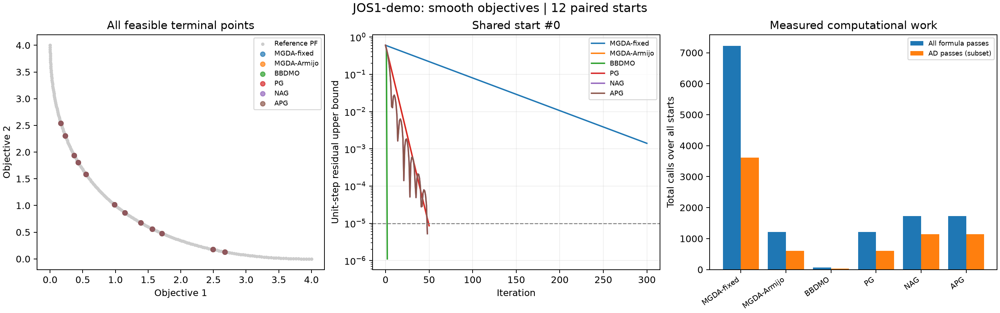
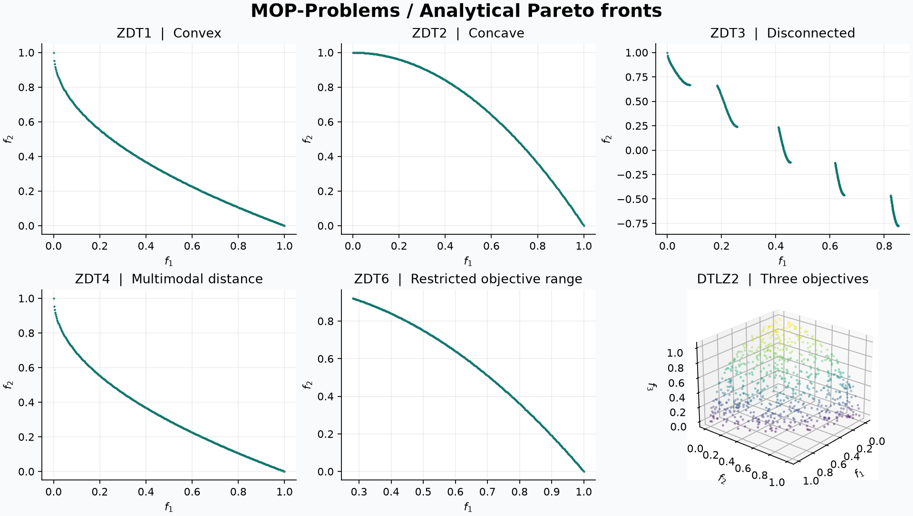
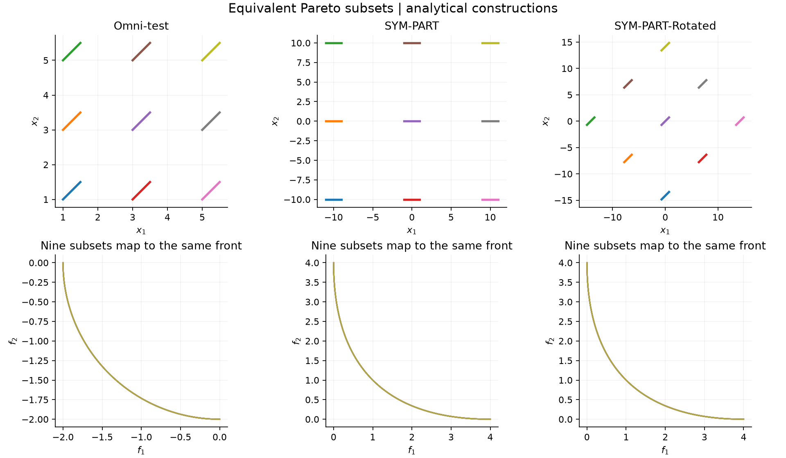

# MOP-Problems

A Python catalogue of **multi-objective optimization benchmark problems**, organized
by problem family, difficulty and constraint type.

[中文说明](README.zh-CN.md) · [Problem catalogue](problems/README.md) ·
[API](docs/api.md) · [Formulas](docs/formulas.md) ·
[Reproducible experiments](docs/experiments.md) · [Contributing](CONTRIBUTING.md)

[Jacobians and smoothness](docs/gradients.md) · [Gradient algorithms](docs/algorithms.md)

**Version 0.3.0: 43 catalogue entries, 47 implemented problems across 15 entries.**
The complete requested taxonomy is present. Entries marked **planned** have source
notes and contribution requirements but no callable implementation. They never
return placeholder objective values. First derivatives and five first-order
algorithm families are available; this is still an alpha research library.

## Install

Python 3.10 or newer is required. From this repository's root:

```sh
python -m pip install -e .
```

NumPy is the only core dependency. The optional `algorithms` extra adds SciPy for
three-or-more-objective inner solves. No package has been published to PyPI yet;
the commands here install this checkout.

## Quick start

```python
from mop_problems import get_problem, list_problems

problem = get_problem("ZDT1", n_var=30)
X = problem.sample(100, seed=42)
result = problem.evaluate(X)

print(result.F.shape)  # (100, 2)
print(result.G.shape)  # (100, 0), no inequalities
print(result.H.shape)  # (100, 0), no equalities
print(result.feasible.all())

constrained = get_problem("BNH")
result = constrained.evaluate([[1.0, 1.0]])
print(result.F)  # [[8. 32.]]
print(result.G)  # [[ -8.  -57.3]], feasible when all G <= 0

many_objective = get_problem("DTLZ2", n_obj=5)  # n_var defaults to 14
print(list_problems(suite="DTLZ"))
```

Every objective is minimized. The numerical contract is `G <= 0`, `H = 0`,
with a configurable equality tolerance. A single vector produces a one-row batch;
empty constraint matrices always retain shape `(N, 0)`. Inputs are checked for
dimension, finite values and bounds. No clipping or objective penalties are applied.
`sample()` samples the variable box, which does not guarantee constraint feasibility.

## Available now

| Family | Implemented problems | Default dimensions |
| --- | --- | --- |
| ZDT | ZDT1, ZDT2, ZDT3, ZDT4, ZDT6 | 2 objectives; 30 or 10 variables |
| DTLZ | DTLZ1–DTLZ7 | 3 objectives; scalable variables and objectives |
| Unconstrained classics | SCH, FON, POL | 2 objectives |
| Constrained classics | BNH, TNK, OSY, SRN | 2 objectives; raw inequality residuals |
| WFG | WFG1–WFG9 | 3 objectives, 24 variables; scalable partition |
| UF | UF1–UF10 | 2 or 3 objectives, 30 variables |
| Multimodal decision sets | Omni-test, SYM-PART, SYM-PART-Rotated | 2 objectives; nine subsets at default dimensions |
| C-DTLZ | C1-DTLZ1/3, C2-DTLZ2, C3-DTLZ1/4 | 3 objectives, 12 variables; scalable |
| Engineering | Welded-Beam | 2 objectives, 4 variables, 4 constraints |

## Gradient algorithms and comparisons

```sh
python -m pip install -e ".[algorithms,plot]"
python examples/gradient_comparison.py --starts 12 --seed 42
```

```python
from mop_problems import get_problem
from mop_problems.algorithms import MGDA, BBDMO

p = get_problem("FON")
x0 = [0.2, -0.1, 0.3]
value, jac = p.evaluate_with_jacobian(x0)
print(jac.dF.shape)  # (1, 2, 3); raw dG and dH use the same last-axis convention
r = MGDA(step_rule="armijo").solve(p, x0)
fixed = MGDA(step_rule="fixed", step_size=0.1).solve(p, x0)
bb = BBDMO().solve(p, x0)
print(r.status, r.nfev, r.njev, r.stationarity_bound)
```

All 47 benchmarks have forward-mode first derivatives at supported regular points.
Detected kinks and singular derivatives are explicit errors. Built-in methods include
MGDA/GD, BBDMO, proximal gradient, and TFY's Nesterov-style accelerated gradient and
accelerated proximal gradient. Objective-specific shifted L1 terms, paired multistarts,
histories, cost accounting and CSV/JSON/NPZ exports are provided.
Methods handle boxes and explicit proximable convex terms; nonlinear `G/H` constraints
require an external constrained solver using the supplied Jacobians.
Stationarity is not a global Pareto-optimality certificate. See the
[usage, formulas and exact variants](docs/algorithms.md) and [derivative caveats](docs/gradients.md).



## Reference fronts

Analytical front sampling is available for ZDT1/2/3/4/6, DTLZ1–6, SCH, FON,
UF1/2/3/4/7/8/10, Omni-test and both implemented SYM-PART variants.
It is explicitly unsupported for other problems; it never downloads reference data
or labels arbitrary objective samples as a true Pareto front.



Generate this figure with `python examples/plot_fronts.py` after installing
`python -m pip install -e ".[plot]"`.

## Representative experiments

Run 14 fixed-seed sampling cases, including 5- and 8-objective examples, plus
analytical decision-set and constrained-surface constructions:

```sh
python -m pip install -e ".[plot]"
python examples/representative_suite.py --samples 2000 --seed 42
```

This writes raw decision/objective/constraint CSV files, a summary, an environment
and parameter manifest, and three figures to `outputs/representative/`.
Use `--no-plots` for NumPy-only execution. See the
[experiment guide and recorded results](docs/experiments.md) for reproduction.
Sample nondominated points are explicitly distinguished from analytical fronts;
these are sampling demonstrations, not optimizer performance comparisons.



## Repository layout

```text
problems/                       # Browsable taxonomy and problem cards
├── unconstrained_smooth/        # ZDT, DTLZ, SCH, FON, POL
├── composite/                  # Transformed, linkage, irregular, large-scale,
│                               # multimodal, dynamic, real-world
└── constrained/                # Classic, DTLZ-based, difficult, large-scale,
                                # multimodal, real-world
src/mop_problems/                # Installable library (src layout)
├── core.py                     # Problem and Evaluation contract
├── catalog.py                  # Discovery and factory
├── differentiation.py          # Derivative metadata and independent validation
├── algorithms/                 # MGDA, BBDMO, PG and accelerated baselines
├── data/catalog.json            # Authoritative metadata and status
└── problems/                   # Actual formula implementations
tests/                          # Analytical, contract and optional reference tests
examples/                       # Evaluation and figure examples
docs/                           # Formulas, sources, conventions and publishing
scripts/build_catalog.py         # Reproducible catalogue generation
.github/                        # CI, issue forms and pull-request template
```

The `unconstrained_smooth` and `composite` names follow the requested taxonomy;
they are organizational labels. They do **not** assert differentiability or a
particular mathematical composite structure. ZDT5 is binary and excluded;
DTLZ8/9 are constrained and are not included under unconstrained DTLZ.
See [taxonomy and scope](docs/taxonomy.md) for real-variable subset rules and variants.

## Discover and validate

```sh
python -m mop_problems list
python -m mop_problems suites --status planned
python -m mop_problems info ZDT1
python -m mop_problems sample DTLZ2 --n 4 --n-obj 5 --seed 42

python -m pip install -e ".[dev,reference,algorithms]"
python -m pytest --cov=mop_problems --cov-report=term-missing
python -m ruff check .
python -m ruff format --check .
python scripts/build_catalog.py --check
python -m build
```

The optional `reference` extra pins **pymoo 0.6.2** for cross-library tests.
Constraint comparisons explicitly undo its scaling where necessary.
The library itself does not import or require pymoo.
CI checks Python versions on Linux, plus Windows and macOS, and tests the built
wheel outside the source tree. The [verification notes](docs/validation.md)
describe numerical evidence and its limits.

## Sources, citation and license

Formula definitions and implementation conventions are linked in the problem cards,
[references](docs/references.md) and [BibTeX](docs/references.bib).
Please cite the **original benchmark paper** when using a problem in research.
`CITATION.cff` describes this software and links the actual GitHub repository.

Original repository code is under the [MIT license](LICENSE). External papers and
implementations retain their own terms; linking to them does not relicense them.
There is no vendored third-party problem code.

To upload this checkout, follow the [GitHub publishing guide](docs/publishing.md).
