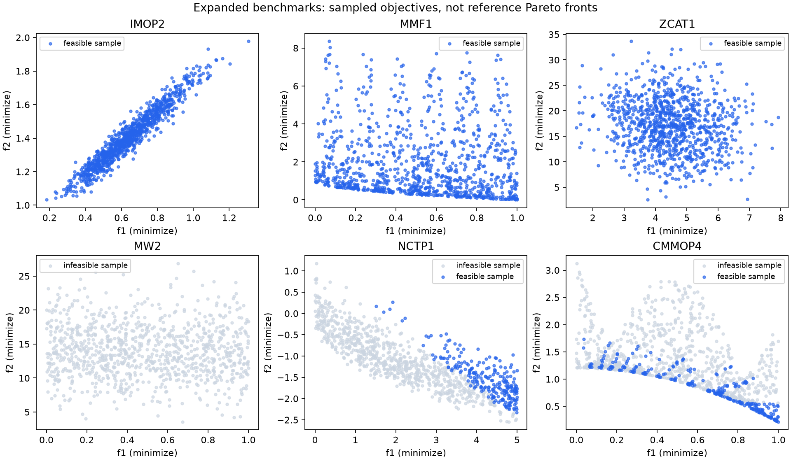
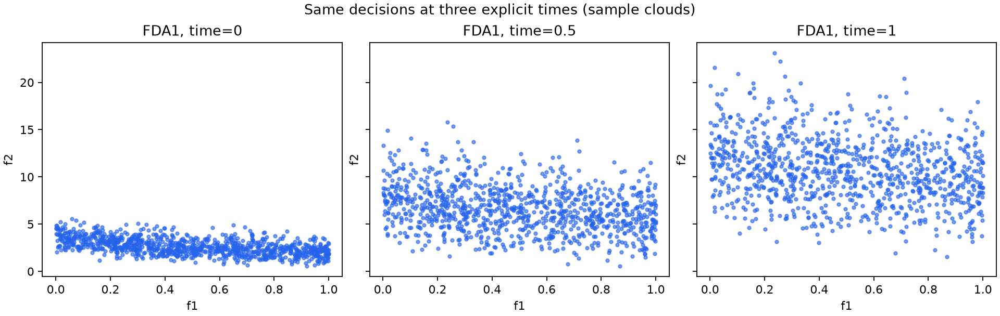
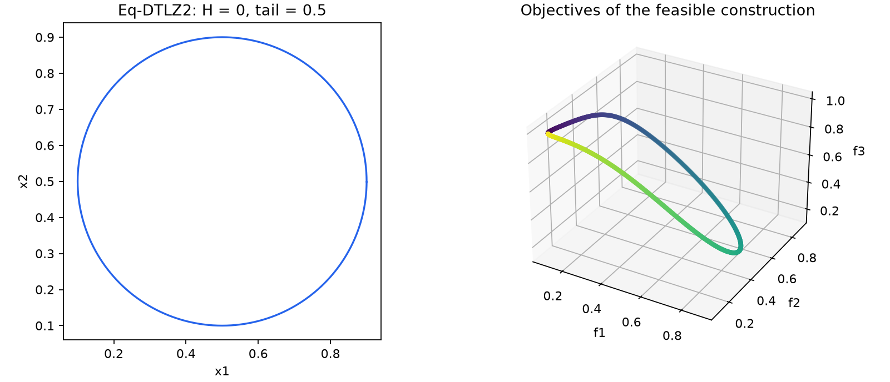

# 新增基准问题的使用 / Expanded benchmarks

0.4.0 补齐原来 28 个 `planned` 问题族，新增 296 个问题，总计 343 个。
可从[问题目录](../problems/README.md)逐级浏览，或用 Python 查询：

```python
from mop_problems import get_problem, get_problem_info, list_problems, list_suites

print(list_problems(suite="MaF"))
assert list_suites(status="planned") == []
info = get_problem_info("LSCMOP1")
for paper in info["references"]:
    print(paper["citation"], paper["url"])
print(info["reference_implementation"])
```

每个问题的卡片均列出论文、参考代码版本、默认维度、边界、约束、导数和变体说明。
工程问题标注所采用的基准套件论文；同名工程模型的历史版本可能不同。
正式实验应同时记录本库版本和实际构造参数，不能只写“采用 MaF”或“采用 RCM”。

## 与自己的算法对接

```python
p = get_problem(
    "ZCAT1", n_obj=3, n_var=12, level=3, bias=False, imbalance=False, complicated_pareto_set=True
)
X = p.sample(32, seed=42)
population = p.evaluate(X)  # 进化/无梯度算法
value, jac = p.evaluate_with_jacobian(X[:1])  # 梯度算法，小批次
F, J = value.F[0], jac.dF[0]  # (3,), (3, 12)
print(jac.dG.shape, jac.dH.shape)
```

`evaluate` 和 `jacobian` 使用同一套公式、目标方向和约束符号。
约束问题的 `G <= 0`、`H = 0`、`dG/dH` 可直接交给支持这些接口的约束算法。
内置 MGDA/BBDMO/PG/加速方法处理变量盒与显式近端项；一般非线性约束需要外部约束算法。
不可微点会明确报错，不能把所有新问题都当成光滑优化实例。

```python
from mop_problems.algorithms import MGDA

p = get_problem("SDTLZ2", n_obj=2, n_var=8, scale=3)
result = MGDA(step_rule="armijo", max_iter=300).solve(p, p.sample(1, seed=42)[0])
print(result.status, result.nfev, result.njev)
```

多算法共享起点、记录预算和导出结果可继续使用
[gradient_comparison.py](../examples/gradient_comparison.py)与[算法指南](algorithms.md)。

## 动态问题

```python
from mop_problems.problems.composite.fda import benchmark_time

p = get_problem("FDA1", time=0.0)
X = p.sample(20, seed=42)
for step in (0, 50, 100):
    t = benchmark_time(step, frequency=10, severity=10)
    snapshot = p.at_time(t)
    print(t, snapshot.evaluate(X).F[0])
assert p.time == 0.0
```

FDA1–5、JY1–8 的时间均由调用者控制。函数求值次数不会改变环境，便于算法公平对比。
Jacobian 是固定时间下对决策变量的导数，不包含时间导数。
若比较动态算法，应另外固定时间调度和每个环境的评价预算。

## 等式和大规模问题

```python
import numpy as np

p = get_problem("Eq-DTLZ2", n_obj=3, n_equalities=1)
x = np.full(p.n_var, 0.5)
x[0] += 0.4  # 位于第一条球面等式上
ev, jac = p.evaluate_with_jacobian(x, equality_tol=1e-6)
print(ev.H, ev.feasible, jac.dH.shape)

large = get_problem("LSCMOP1", n_var=1000)
x = large.sample(1, seed=42)
print(large.evaluate(x).F)
print(large.jacobian(x).dF.shape)
```

Eq-DTLZ1–4、Eq-IDTLZ1/2 支持一条或两条等式，`n_obj >= n_equalities + 1`。
`equality_tol` 只影响可行性，不改写 `H` 或 `dH`；均匀盒采样通常不能得到等式可行点。

LSCMOP 保留作者单列**聚合违反量**与数值截断，因此它的 `dG` 不能替代原始各约束的梯度。
LSMOP、LSCMOP 的前向 Jacobian 种子内存为 `O(N*n_var²)`；大维度应采用小批次，
同时记录导数耗时。不得把一次 Jacobian 与一次目标求值算成同等成本。

## 常用构造参数

| 问题族 | 参数或限制 |
| --- | --- |
| IDTLZ / SDTLZ | `n_obj`, `n_var`；SDTLZ 可设 `scale > 0` |
| IMOP | `n_var`, `k`, `a1`, `a2`；默认 10、5、0.05、10 |
| MaF | `n_obj`, `n_var`；MaF8/9 固定两个决策变量；MaF9 拒绝无效多边形 |
| ZCAT | `n_obj`, `n_var`, `level=1..6`, `bias`, `imbalance`, `complicated_pareto_set` |
| LSMOP | `n_obj`, `n_var`, `nk`；子组至少含两个变量 |
| LSCMOP | `n_var` 默认 100；维度需满足来源的分组整除要求，不自动改成其他维度 |
| CTP | `n_var`, `distance="linear"/"multimodal"`；CTP1 可设 `n_constraints` |
| DASCMOP | `difficulty=1..16` 或 `(eta,zeta,gamma)` |
| DASCMaOP | `difficulty=1..12` 或三元组，另可设 `n_obj`, `n_var`, `k` |
| FDA / JY | 显式 `time`；FDA2 要求奇数 `n_var` |
| Eq-DTLZ / Eq-IDTLZ | `n_obj`, `n_var`, `n_equalities=1/2` |
| MMF / CMMOP / RE / CRE / RWA / RCM | 来源固定维度；以各卡片为准 |

别名包括 `NCTP-I-1` → `NCTP1`、`NCTP-II-1` → `NCTP7`、
`NCTP-III-1` → `NCTP13`、`LSCM1` → `LSCMOP1`、`RWMOP50` → `RCM50`。
这些别名不增加问题计数。

## 可复现计算与可视化

```sh
python -m pip install -e ".[plot]"
python examples/expanded_benchmarks.py --samples 1000 --seed 42
```

脚本生成 10 个代表性静态问题、3 个 FDA1 时间快照和 1 个 Eq-DTLZ2 可行圆环构造。
NCTP 示例显式在 Rosenbrock 谷附近采样，其余静态例子使用盒采样。
输出位于 `outputs/expanded/`：14 个 CSV、`manifest.json` 和 3 张 PNG。
清单记录全部构造参数、种子、环境版本、论文、参考实现版本、数据哈希和一个点的完整 Jacobian。
`--no-plots` 可仅依赖 NumPy 运行。

图中的随机目标点是采样云，不能当作真实 Pareto 前沿或算法性能结果。
例子不运行优化器；正式对比请固定初始点、预算、停止规则、约束容差和时间调度，
并使用匹配问题版本的参考前沿。详见[核验说明](expanded-validation.md)。

以下为 `--samples 1000 --seed 42` 的输出；
[运行清单](assets/expanded_manifest.json)保留参数、来源与 CSV 哈希。






