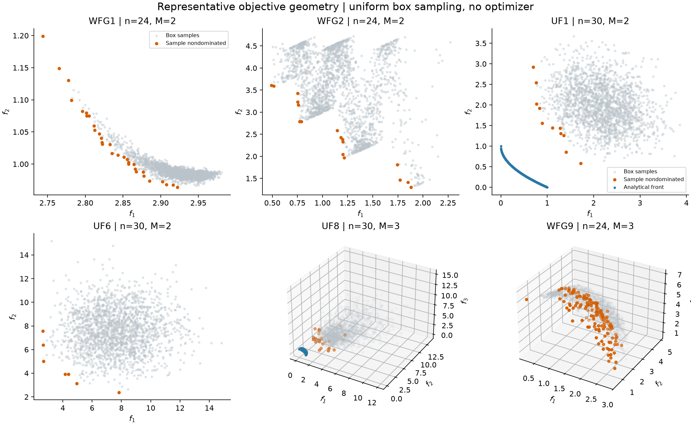
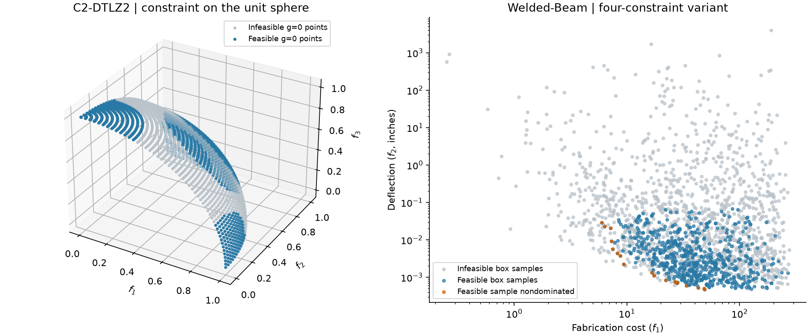

# 代表性问题实验 / Reproducible experiments

0.2.0 增加 28 个基准问题，提供 **14 组固定种子采样实验**，以及多个等价
Pareto 解集和约束曲面的解析构造。所有数值都由仓库中的公式计算，图表可以重新生成。
这些实验用于理解问题特征和检查调用流程，没有运行优化算法，也不作算法性能排名。

## 选择依据

| 实验 | 代表性特征 | 本次配置 |
| --- | --- | --- |
| WFG1、WFG2 | 偏置、平坦变换、非可分性和断裂结构 | n=24，M=2，k=4 |
| WFG3、WFG9 | 退化结构、参数依赖和非可分性 | n=24，M=3，k=4 |
| UF1、UF5、UF6 | 变量耦合、离散或断裂前沿 | n=30，M=2 |
| UF8、UF9 | 三目标球面和断裂结构 | n=30，M=3 |
| C2-DTLZ2、C3-DTLZ4 | 目标空间中的球形或椭球约束 | n=12，M=3 |
| Welded-Beam | 工程成本与挠度权衡、四个约束 | n=4，M=2 |
| DTLZ2、WFG9 | 增加目标数量后的非支配关系 | M=5、8；n=14、34 |
| Omni-test、SYM-PART、SYM-PART-Rotated | 多个决策解集映射到同一目标前沿 | 每个问题完整构造 9 个解集 |

前七行合计 14 组均匀变量盒采样实验。最后一行单独按已知解析解构造，
不与随机采样混在一起计算非支配比例。

## 一键复现

在仓库根目录执行：

```sh
python -m pip install -e ".[plot]"
python examples/representative_suite.py --samples 2000 --seed 42
```

仅需要数值结果时，不安装绘图依赖也可以运行：

```sh
python -m pip install -e .
python examples/representative_suite.py --samples 2000 --seed 42 --no-plots
```

默认输出目录是 `outputs/representative/`，可以通过 `--output` 修改。
复现记录见 [manifest.json](experiments/representative/manifest.json)，包含实际
Python、NumPy、Matplotlib 版本、脚本 SHA-256、问题参数、边界和每组种子。
每组使用 `base_seed + case_index`；随机生成器为 NumPy 的 PCG64。
这里的汇总使用每组 2000 个样本，基础种子为 42。更换样本数或种子会改变结果。

同一代码、环境和参数下，CSV 导出可重复。不同平台或数值库版本的浮点尾数、
极近点的支配关系和 PNG 渲染可能不同，科学比较时应保留自己的复现记录。
CI 使用 128 个样本验证绘图流程，不能把该小样本结果与这里的 2000 样本汇总直接比较。

## 输出内容

| 文件 | 内容 |
| --- | --- |
| 每组的 CSV | 全部 x、f、原始 g、CV、可行性和样本非支配标记 |
| summary.csv | 维度、约束数、样本数、种子、可行点数、非支配点数和可行比例 |
| manifest.json | 环境、方法、参数、变量边界、复现信息 |
| 支持解析前沿的问题的 reference.csv | 与决策采样分开的目标空间参考点 |
| omni_sets.csv、sympart_sets.csv、sympart_rotated_sets.csv | 解集编号、决策坐标、目标坐标 |
| c2_dtlz2_g0_surface.csv | 51×51 位置网格的目标、约束和可行性 |
| objective_geometry.png | 六个代表性问题的目标空间图 |
| multimodal_sets.png | 三个多模态问题的决策解集和共同前沿 |
| constraint_geometry.png | C2-DTLZ2 约束曲面及 Welded-Beam 可行设计权衡 |

原始批量输出位于被 Git 忽略的 `outputs/`。仓库保留
[数值汇总](experiments/representative/summary.csv)、复现记录和三张图；完整 CSV 可由命令生成。
CSV 的 `sample_nd=1` 表示该点在**本次可行样本中**不被其他点支配。
所有目标按最小化判断，全部原始不等式 `G<=0` 才是可行点，完全相同的目标行保留。
不对原始约束加隐藏容差或归一化。

## 已运行结果与解读

| 问题 | 样本数 | 可行点数 | 可行样本中的非支配点数 |
| --- | ---: | ---: | ---: |
| WFG2，2 目标 | 2000 | 2000 | 17 |
| WFG9，3 目标 | 2000 | 2000 | 152 |
| UF1 | 2000 | 2000 | 11 |
| C2-DTLZ2 | 2000 | 14 | 11 |
| C3-DTLZ4 | 2000 | 498 | 58 |
| Welded-Beam | 2000 | 627 | 18 |
| WFG9，8 目标 | 2000 | 2000 | 1567 |

可行比例是这次变量盒采样的观测值，不是可行域体积的精确值。样本非支配点数受
维度、分布和预算共同影响，不能作为跨问题的质量评分，也不能证明算法收敛。
没有计算缺少可靠参考前沿时的 IGD，也没有使用随意选择的参考点报告 HV。



灰色是变量盒采样得到的目标点，橙色是在这些样本内的非支配点，蓝色是受支持的
解析前沿。UF1、UF8 中两者的差距直观说明：均匀采样通常难以接近耦合问题的最优解集。
WFG、UF5/6/9 没有在公共接口中提供完整前沿采样器，本图也没有将采样点称为真实前沿。


上排每种颜色代表不同决策解集；下排对应的目标曲线重合。
每个解集取 101 个参数点，总计每个问题 909 行。Omni-test 使用各坐标相同的
相位参数加上周期偏移，SYM-PART 使用九条线段，旋转版按指定角度旋转。
只检查目标前沿无法判断是否找齐了所有等价决策解集。



左图将 C2-DTLZ2 的距离变量固定为 0.5，在单位球面上分别标出可行和不可行点。
这个网格与随机采样的 14 个可行点统计分开记录。右图按可行性区分 Welded-Beam
样本，并在可行点内筛选非支配点；坐标使用对数刻度。
Welded-Beam 的版本差异和约束尺度见[完整公式](formulas.md#welded-beam)。

## 数值核验

新增问题经过解析点、约束符号、维度、边界及空批次测试。WFG、C-DTLZ、Omni-test、
SYM-PART 和 Welded-Beam 与固定版本 pymoo 0.6.2 比较；UF 使用独立标量公式和解析
耦合最小点核验。测试还检查 CSV 重现性、可行性过滤和非支配判定。
详见[验证说明](validation.md)，并可运行：

```sh
python -m pip install -e ".[dev,reference]"
python -m pytest --cov=mop_problems --cov-report=term-missing
```
