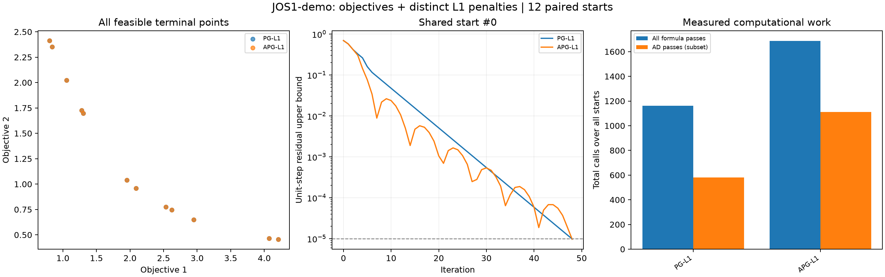

# Gradient release verification / 梯度版验证记录

本记录对应 0.3.0 的导数与一阶算法扩展；原有采样实验的记录保留在
[experiments.md](experiments.md)，不将旧输出误标为算法实验。

2026-09-23 本机 Windows / Python 3.14.6 / NumPy 2.5.3 / SciPy 1.18.1：
完整测试 **640 项通过**（含原有 103 项 pymoo 0.6.2 参考比较），总覆盖率约 **95%**。
Ruff、目录生成一致性与文档链接检查通过。完整数据环境见下方 manifest。

## 验证范围

- 全部 47 个已注册问题：前向 Jacobian 与独立差分，默认和变更维数/参数，
  原始 dG/dH 符号，批次/单点/空批次，输入不变与返回数组只读。
- FON、BNH、Omni-test、DTLZ 特殊点的独立解析导数，含零因子的乘积。
- ZDT/DTLZ/UF/TNK 的奇异导数、UF/SYM-PART 分支检查与显式分支导数选项。
- 双目标最小范数组合的闭式解、三目标已知最优权重、带活动边界的子问题。
- L1 的独立标量优化比较、加速目标差值模型的独立原始 epigraph 优化，
  多步 Nesterov 递推、BBDMO 三种曲率情形及首步与 MGDA 一致性。
- 固定步长手算轨迹、Armijo 不等式、最大值/平均值非单调配置、
  残差诊断、预算约束、内层失败不可冒充收敛、相同起点重复运行。
- 新例子的 CSV/JSON/NPZ 数据一致性、共享起点、复合目标与完整失败状态。

## 复现实验

```sh
python -m pip install -e ".[dev,reference,algorithms,plot]"
python -m pytest --cov=mop_problems --cov-report=term-missing
python -m ruff check .
python -m ruff format --check .
python scripts/build_catalog.py --check
python examples/gradient_comparison.py --starts 12 --seed 42 --output outputs/gradient_release
python -m build
python -m twine check dist/mop_problems-0.3.0*
python scripts/check_wheel.py dist/mop_problems-0.3.0-py3-none-any.whl
```

提交的轻量实验记录在 [summary.csv](experiments/gradients/summary.csv) 和
[manifest.json](experiments/gradients/manifest.json)。它们对应默认 JOS1 示范的
12 个共享起点、种子 42、每个起点最多 300 次更新。运行脚本会重新产生全部
逐次轨迹和终点 NPZ/JSON；这些较大的输出保存在忽略的 `outputs/` 中。
`seconds` 为该次本机测量，不保证跨运行一致；初始点、参数和成功/失败状态均有记录。




这两张图是特定设置的计算结果，不是算法优劣的普遍排名。
NAG/APG 可有振荡，可能在某个问题上比无加速方法慢。
MGDA 固定 `0.1` 步长可能在 300 次更新内未到阈值，CSV 会保留 `max_iter`。
驻点率不等于前沿覆盖率或全局最优率；加入 L1 后须使用改变后的完整目标。

三目标 DTLZ2 及 FON 还可通过同一示例的 `--problem` 参数运行。
它们是非凸验证例，不能以凸收敛率解释其每条轨迹。
库的适用边界与算法论文对应关系见[算法指南](algorithms.md)。
